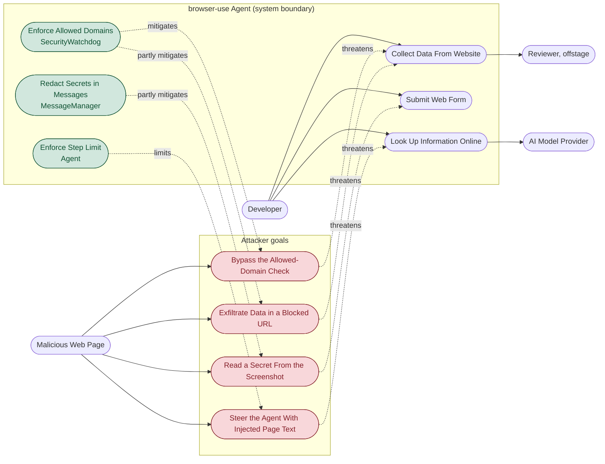

# Misuse Case Diagram

Extends the use case diagram from the Requirements and Use Cases page. Normal use is on the left,
attacker behaviour on the right. Dashed arrows are labelled `threatens` (misuse case against a use
case) and `mitigates` (control against a misuse case).

Every misuse case here is grounded in something specific: a published advisory against this
project, or behaviour I reproduced on my own machine.

## Where each misuse case comes from

| Misuse case | Evidence |
|---|---|
| M1 Bypass the Allowed-Domain Check | CVE-2025-47241 (GHSA-x39x-9qw5-ghrf), CVSS 9.3, fixed in 0.1.45: a decoy domain in the HTTP auth username portion of a URL defeated `_is_url_allowed`. The same class recurred in PR #4866, non-standard IPv4 forms defeating `block_ip_addresses`. |
| M2 Exfiltrate Data in a Blocked URL | Reproduced locally with `allowed_domains=['example.com']`: `BrowserSession.on_NavigateToUrlEvent` runs before `SecurityWatchdog.on_NavigateToUrlEvent`, so the request reaches the blocked host and the tab is only switched to `about:blank` afterwards. Anything in the URL has already been sent. |
| M3 Read a Secret From the Screenshot | Reproduced locally: with `sensitive_data` set, the page text sent to the model contained `<secret>customer_email</secret>`, but the screenshot showed the real address and the model repeated it in its own reasoning. With `use_vision=False` it never saw the value. |
| M4 Steer the Agent With Injected Page Text | The agent reads page content and decides its next action from it, so text on a page is untrusted input to the decision loop. `Agent` warns about exactly this when `sensitive_data` is used without `allowed_domains` locked down (`agent/service.py:540`). |

## Partial mitigations, stated plainly

- **C1 does not fully stop M2.** The check runs, but after the request has left the machine.
- **C2 does not stop M3 at all when screenshots are on.** Redaction covers message text, not images.
- **C3 limits M4's blast radius** by capping how many steps an injected instruction can drive; it
  does not detect the injection.
