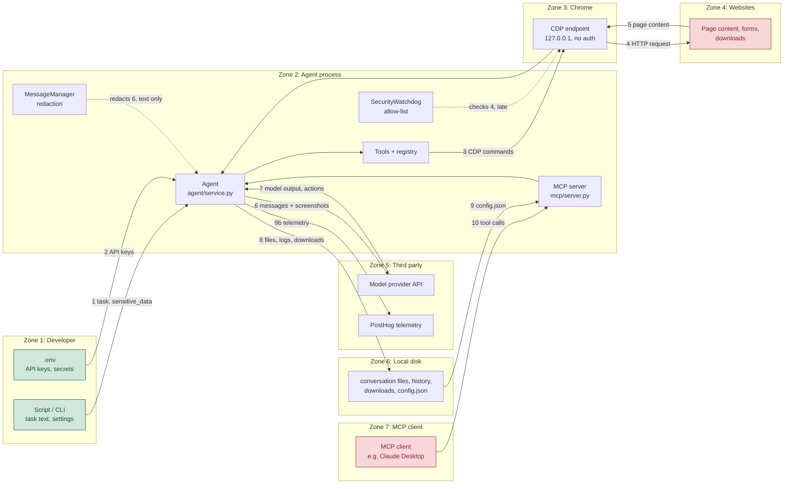

# Trust Boundary Diagram

Components of browser-use grouped by trust zone. Every numbered arrow crosses a boundary where
trust changes; those ten crossings are the attack surface.

## What validates each crossing

| # | Crossing | What validates it | Who owns the check |
|---|---|---|---|
| 1 | Developer script to Agent | Pydantic models on every `Agent` parameter; secrets passed as `sensitive_data` and referenced by placeholder | `Agent`, pydantic |
| 2 | `.env` to provider client | Presence only. `ChatDeepSeek` raises if the key is missing (`deepseek/chat.py:56`). No scope, expiry or rotation | each `Chat*` class |
| 3 | Agent to Chrome over CDP | **Nothing.** The endpoint binds `127.0.0.1` on a random port (`local_browser_watchdog.py:115, 402`) and CDP has no authentication | nobody |
| 4 | Chrome to website | `SecurityWatchdog._is_url_allowed`, but **after** the request is issued (`security_watchdog.py:35`, see Misuse Case 1) | `SecurityWatchdog`, late |
| 5 | Website content into the agent's state | **Nothing semantic.** Content is truncated at 100,000 characters and serialized, never treated as untrusted instructions | nobody |
| 6 | Agent to model provider | `MessageManager._filter_sensitive_data` (`message_manager/service.py:577`) redacts message **text**; screenshots are not redacted | `MessageManager`, partial |
| 7 | Model output back into the agent | Structure is validated: `AgentOutput` is parsed by pydantic and action names must exist in the registry | `Agent`, `Tools` registry |
| 8 | Agent to local disk | Page-supplied download names pass `_sanitize_download_filename`; `upload_file` refuses paths outside `available_file_paths` (`tools/service.py:869`). Conversation files are written **unredacted** | `DownloadsWatchdog`, `Tools`; nobody for logs |
| 9 | `config.json` to MCP profile | **Nothing.** A malformed file is caught, replaced with a fresh default and written back, dropping `allowed_domains` (issue #6218, open, 2026-10-26) | nobody, fails open |
| 10 | External MCP client to MCP server | No authentication in `mcp/server.py`; `allowed_domains` applies only if the caller passes it or config supplies it | nobody |

## Findings, stated plainly

Crossings **3, 5, 9 and 10 validate nothing**. Crossings **4 and 6 validate partially**, and both
partial failures are the misuse cases in Part 2. Only crossings **1, 7 and 8** are meaningfully
checked, and 8 only for filenames and upload paths, not for the secrets written into logs.

## One place the project trusts something it should verify

**Crossing 5: page content entering the decision loop.** The agent reads whatever a website shows
and feeds it to the model as state. The structure of that content is handled carefully, with a DOM
tree, element indices and a character cap, but its *provenance* is never considered. Text written by
an attacker arrives in the same channel, and with the same authority, as the developer's own task.

If that trust is misplaced, the page is no longer data, it is instructions. A page can tell the model
to visit another address, type a value it was given into a different field, or download a file, and
the agent will do it, because deciding what to do next from page content is its entire purpose.
Crossing 4's late check limits where it can go, but as Misuse Case 1 shows, the request is sent
before the check runs. The project knows this: `Agent` warns when `sensitive_data` is configured
without `allowed_domains` locked down (`agent/service.py:540`), which is an acknowledgement that
page content can redirect the agent, handled with a warning rather than a control.

Runners-up worth naming: crossing 3, where any local process that can reach the CDP port can drive
the browser and read its session, and crossing 9, where a corrupt config file silently becomes an
allow-all profile.
